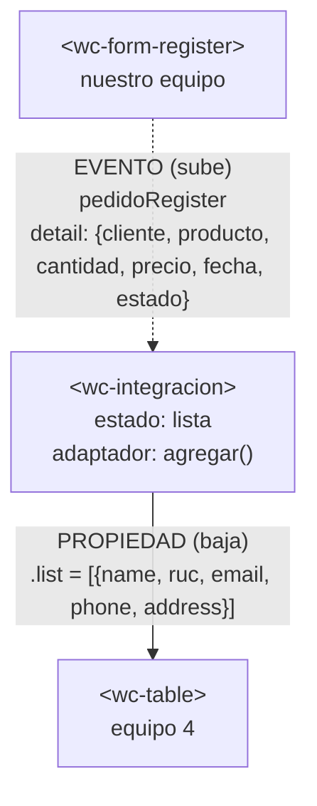

# Integración con el componente de otro equipo

## 1. Datos

| Campo | Valor |
|---|---|
| Equipo | Equipo 3 · Gestión de pedidos |
| Equipo externo | Equipo 4 · Gestión de proveedores |
| Repositorio externo | https://github.com/Raxii/app-lit-grupo1 (el repositorio del Equipo 4 se llama `app-lit-grupo1`) |
| Archivo externo | `src/views/home/table.js` → copiado en `src/externos/equipo-4/table.js` |
| Commit usado | `e5d1199` (rama `taller-integracion` del Equipo 4; su `main` estaba vacío) |

## 2. Componentes y roles

| Componente | Archivo | Origen | Rol |
|---|---|---|---|
| `<wc-integracion>` | `src/views/integracion/integracion.js` | Nuestro equipo | **Padre**. Dueño del estado `lista`. Escucha el evento del formulario, adapta el dato y pasa la lista a la tabla. |
| `<wc-form-register>` | `src/views/home/register.js` | Nuestro equipo | **Hijo**. Emite el evento `pedidoRegister` con `detail: { cliente, producto, cantidad, precio, fecha, estado }`. |
| `<wc-table>` | `src/externos/equipo-4/table.js` | Equipo 4 | **Hijo**. Recibe la lista por la propiedad `.list` con objetos `{ name, ruc, email, phone, address }`. |

## 3. Flujo de comunicación



**Adaptador.** El formulario envía un pedido y la tabla del Equipo 4 espera un proveedor; ningún nombre de campo coincide. La conversión se hace en el padre, nunca dentro del componente externo:

| Columna de la tabla | Campo que espera | Qué le pasamos |
|---|---|---|
| Razón social | `name` | `cliente` |
| RUC | `ruc` | `"—"` (un pedido no tiene RUC) |
| Correo | `email` | `"—"` |
| Teléfono | `phone` | `"—"` |
| Dirección | `address` | resumen del pedido: `"2 × Café · $7.00 · Pendiente"` |

Usamos la columna Dirección para el resumen del pedido para no perder el producto, el total y el estado. Los valores por defecto (`|| 0`, `|| "Sin cliente"`) evitan errores si llega un dato vacío, y se crea un arreglo nuevo para que Lit vuelva a renderizar la tabla.

```js
agregar(event) {
  let pedido = event.detail || {};
  let cantidad = Number(pedido.cantidad) || 0;
  let precio = Number(pedido.precio) || 0;
  let total = (cantidad * precio).toFixed(2);

  let fila = {
    name: pedido.cliente || "Sin cliente",       // Razón social ← cliente
    ruc: "—",                                    // un pedido no tiene RUC
    email: "—",                                  // ni correo
    phone: "—",                                  // ni teléfono
    address: `${cantidad} × ${pedido.producto || "Sin producto"} · $${total} · ${pedido.estado || "Pendiente"}`,
  };

  console.log("detail recibido:", pedido, "→ fila adaptada:", fila);

  // Arreglo NUEVO para que Lit vuelva a renderizar la tabla
  this.lista = [...this.lista, fila];
}
```

## 4. Dificultades

| # | Integrante | Síntoma | Causa | Solución |
|---|---|---|---|---|
| 1 | Segovia Israel | Al registrar un pedido aparecía una fila nueva, pero con todas las celdas vacías. | El formulario envía `cliente, producto, cantidad...` y la tabla del Equipo 4 lee `name, ruc, email, phone, address`; ningún nombre coincide. | Adaptador en `agregar()` del padre que convierte el `detail` al formato de la tabla, sin tocar el componente externo. |
| 2 | Pinto Diego | Riesgo de error `the name "wc-table" has already been used` al cargar la página. | Los dos equipos registran la etiqueta `<wc-table>`; si se importa nuestro `home.js` o `table.js` junto con la tabla del Equipo 4, `customElements.define` falla. | El padre importa solo nuestro `register.js` y la `table.js` copiada del Equipo 4. |
| 3 | Pinto Diego | VS Code subrayaba `.list` en rojo: *"Type 'any[]' is not assignable to 'never[]'"* (lit-plugin). | La tabla del Equipo 4 inicializa `this.list = []` sin declarar el tipo, y lit-plugin lo deduce como `never[]`. | Se comprobó en el navegador que funciona y que la consola no tiene errores: es un aviso del editor, no un error de ejecución. No se modificó el componente externo; se propuso un JSDoc en el issue. |
| 4 | Segovia Israel | Error rojo `404 (Not Found) favicon.ico` en la consola. | El navegador pide un ícono automáticamente y el proyecto no tiene uno. | Se agregó `<link rel="icon" href="data:," />` en `integracion.html`. |
| 5 | Pinto Diego | Los commits aparecían con un usuario distinto al de la cuenta dueña del repositorio. | GitHub asigna el autor por el correo de `git config user.email`, no por la cuenta con la que se inicia sesión en VS Code. | Se verificó qué cuenta tiene ese correo (`diegoxavierpinto`) y se usa ese usuario en esta documentación. |
| 6 | Nogales Santiago | En el issue, `@type` se convirtió en una mención a otro usuario y `<b>Ana</b>` se mostró en negrita. | Al copiar el texto se perdieron las comillas invertidas que lo marcaban como código. | Se editó el issue pegando el texto con el código entre comillas invertidas. |
| 7 | Pinto Diego | El enlace del repositorio del Equipo 4 cambió durante el taller. | El Equipo 4 renombró su repositorio a `app-lit-grupo1`. | Se comprobó que el commit `e5d1199` y el archivo seguían iguales y se actualizó la URL. |

## 5. Evaluación del componente externo

| Aspecto | Nota (0–5) | Evidencia |
|---|---|---|
| API clara | 3 | La propiedad `.list` tiene un nombre claro, pero no hay README: los campos (`name, ruc, email, phone, address`) se descubrieron leyendo el código. Su `main` está vacío y el componente estaba solo en la rama `taller-integracion`. `list` no declara su tipo y lit-plugin marca `.list` con *"Type 'any[]' is not assignable to 'never[]'"*. |
| Evento bien construido | No aplica | `<wc-table>` solo recibe datos y no emite eventos. El evento de esta integración (`pedidoRegister`) es de nuestro formulario. |
| Robustez | 3 | Con la lista vacía muestra *"No hay proveedores registrados."* y los campos faltantes no salen como `undefined` (`?? ""`). El texto con HTML se muestra escapado. Pero si `.list` llega `undefined` lanza `TypeError: Cannot read properties of undefined (reading 'length')` (`table.js:81`). Detalle menor: muestra "1 proveedores". |
| Encapsulamiento | 5 | Sus estilos están en el shadow DOM: no afectaron nuestro formulario y nuestros estilos no la rompieron. |
| Reutilización | 4 | Se usó copiándola sin cambios y solo depende de `lit`. La etiqueta genérica `wc-table` choca con nuestra tabla, así que tuvimos que evitar importar la nuestra. |

Issue abierto: https://github.com/Raxii/app-lit-grupo1/issues/2

## 6. Uso de IA

| Herramienta | Quién la usó | Para qué | Qué cambiamos |
|---|---|---|---|
| Claude | Todo el equipo | Entender cómo funciona el componente del Equipo 4: qué propiedad recibe (`.list`) y qué campos espera cada objeto. | Lo comprobamos leyendo su `table.js` y probándolo en `integracion.html`. |
| Claude | Todo el equipo | Entender cómo hacer el adaptador, porque la tabla mostraba filas vacías y no sabíamos por qué los datos de la lista no aparecían. | Decidimos qué campo del pedido va en cada columna y probamos en el navegador la lista vacía, los datos de texto y la consola sin errores antes de hacer commit. |

## 7. Aportes del equipo

Cada integrante hace commits con su propia cuenta de GitHub. Quien no tenga commits propios en el pull request se califica aparte.

| Integrante | Usuario de GitHub | Rol | Qué hizo | Enlace a sus commits |
|---|---|---|---|---|
| Pinto Diego | @diegoxavierpinto | 1 · Integración | Creó la rama `taller-integracion`, fijó el commit `e5d1199`, copió `table.js` del Equipo 4 sin cambios, creó `<wc-integracion>` y abrió el pull request. | [commits](https://github.com/DiegoPintoSEGO/app-lit-grupo3/commits/main?author=diegoxavierpinto) |
| Segovia Israel | @ISRAELSY711 | 2 · Adaptador y pruebas | Escribió el adaptador del `detail`, creó `integracion.html`, probó la lista vacía, los datos de texto y la consola, y tomó la captura. | [commits](https://github.com/DiegoPintoSEGO/app-lit-grupo3/commits/main?author=ISRAELSY711) |
| Nogales Santiago | @smnogales-byte | 3 · Revisión externa | Llenó la tabla de evaluación y abrió el issue en el repositorio del Equipo 4. | [commits](https://github.com/DiegoPintoSEGO/app-lit-grupo3/commits/main?author=smnogales-byte) |
| Peñaherrera Jhaldry | @SantyRojas-2005 | 4 · Documentación | Escribió `integracion.md` con el diagrama Mermaid y las dificultades, y revisó y fusionó el pull request (la revisión y la fusión las hizo desde su otra cuenta, @SantyRojas2005). | [commits](https://github.com/DiegoPintoSEGO/app-lit-grupo3/commits/main?author=SantyRojas-2005) |

Pull request: https://github.com/DiegoPintoSEGO/app-lit-grupo3/pull/2 · Revisado por: Peñaherrera Jhaldry
